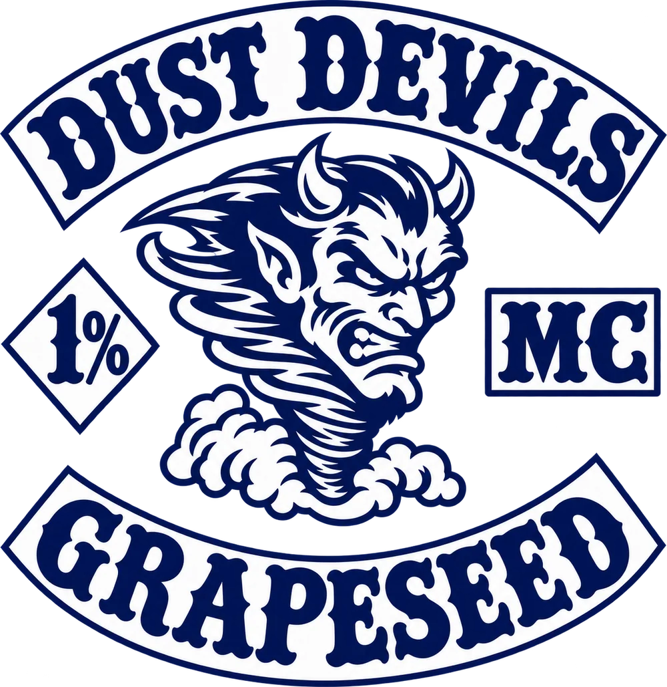
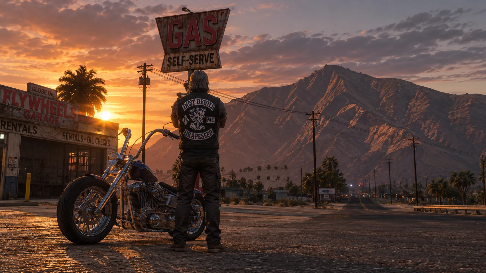
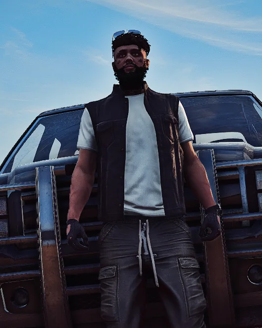
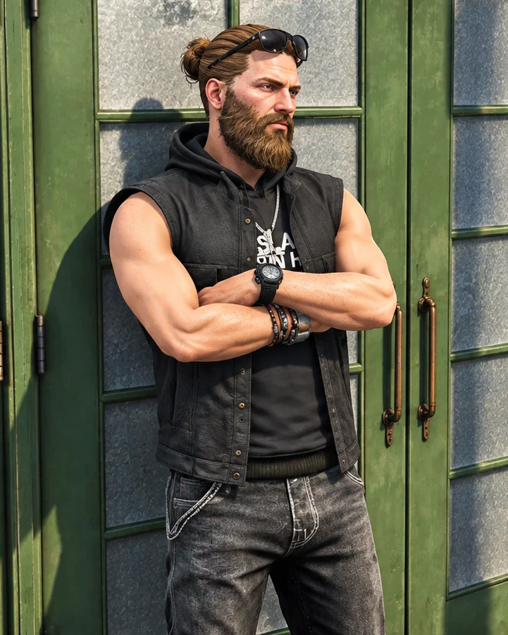
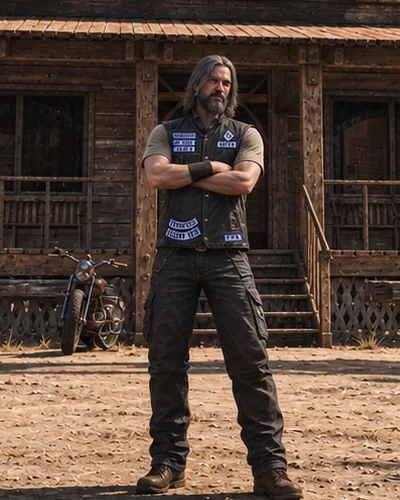
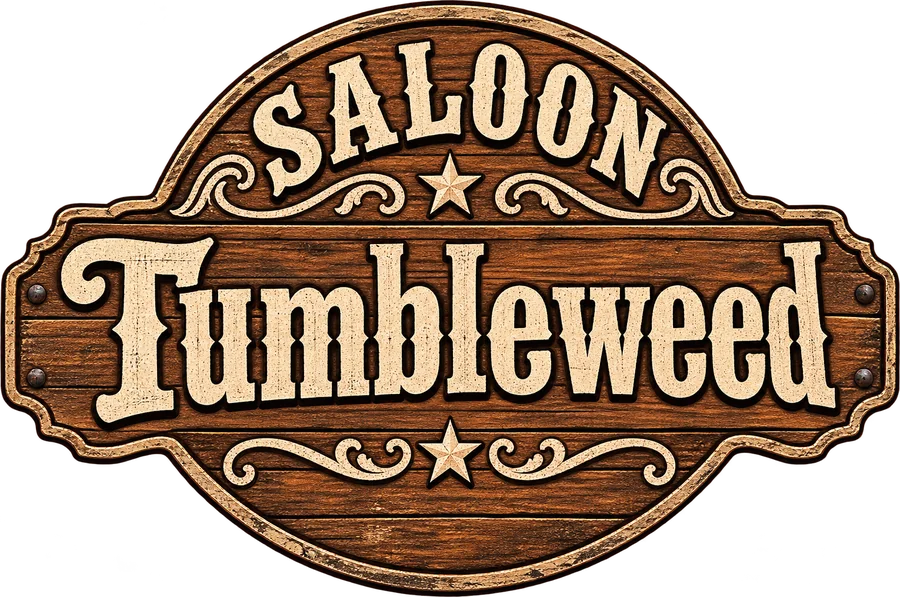

<div align="center">



# Dust Devils MC

**Grapeseed, Blaine County, San Andreas**

*« Nos pères ont écrit les premières pages.<br>À nous de faire en sorte que leur histoire ne s'arrête jamais. »*

[Le club](#le-club) · [Les membres](#les-membres) · [Nos valeurs](#nos-valeurs) · [Les lois](#les-lois) · [Le Tumbleweed](#le-tumbleweed) · [Rejoindre](#rejoindre) · [Le site](#le-site)



</div>

## Le club

Earl Cooper et Marty Anderson ont grandi ensemble à Blaine County. En 1990, à vingt ans, ils rejoignent les Marines. En 1991, ils font la guerre du Golfe. De retour au pays, ils fondent avec les premiers membres, les **First 9**, un club à leur image : un engagement, une parole donnée et des hommes sur lesquels compter.

Marty est mort. Earl a laissé le premier plan à la nouvelle génération. Rick, le fils de Marty, a pris la présidence, avec Travis, le fils d'Earl, à ses côtés. Ensemble, ils reconstruisent le club depuis ses fondations.

## Les membres

<table>
  <tr>
    <td align="center" width="25%"></td>
    <td align="center" width="25%"></td>
    <td align="center" width="25%"></td>
    <td align="center" width="25%"></td>
  </tr>
  <tr>
    <td align="center"><strong>Rick Anderson</strong><br>Président</td>
    <td align="center"><strong>Travis Cooper</strong><br>Vice-président</td>
    <td align="center"><strong>Earl Cooper</strong><br>Secrétaire, First 9</td>
    <td align="center"><strong>Mike Armstrong</strong><br>Sergent d'armes</td>
  </tr>
  <tr>
    <td valign="top">Méfiant, rancunier, bon vivant. Il fait vivre la mémoire de son père.</td>
    <td valign="top">Grande gueule et déconneur. La moto est sa thérapie, le club sa famille.</td>
    <td valign="top">Ancien Marine et fondateur. Un cigare, un whisky, aucune patience pour les excuses.</td>
    <td valign="top">Cousin de Rick, mécano au sang chaud. Il répare les machines et règle les problèmes.</td>
  </tr>
</table>

## Nos valeurs

- **La loyauté.** La famille n'est pas toujours une question de sang.
- **La parole donnée.** Une promesse faite est une promesse tenue.
- **Le respect.** Il se mérite, il ne se réclame pas.
- **La fraternité.** Un frère ne se laisse jamais tomber.
- **Les actes.** On assume ses erreurs.

## Les lois

1. Fraternité, respect, loyauté
2. Les couleurs du club
3. La famille et les proches
4. La loi du silence
5. Le respect des civils
6. Le respect des femmes
7. Interdiction des stupéfiants au sein du club
8. Discipline et hiérarchie

Le texte complet est sur la page `lois.html` du site.

## Le Tumbleweed



Le saloon d'Earl, notre point de ralliement. Un comptoir en bois, des bouteilles alignées derrière le bar, les membres du club et les habitués de la région.

Pour Earl, une bonne journée commence avec un café noir, un cigare et un verre de whisky.

<br clear="right">

## Rejoindre

Personne n'entre au club parce qu'il le demande. On y entre parce qu'on l'a mérité.

1. **Se montrer.** Passe au Tumbleweed, bois un verre, roule avec nous.
2. **Prospect.** Apprends les règles du club et tiens ta parole.
3. **Les couleurs.** Le temps, les actes et la confiance ont parlé.

**[Rejoindre le Discord](https://discord.gg/R6D7M2tH7t)**

<p align="center">
  
  
</p>

---

## Le site

HTML, CSS et JavaScript, sans installation. Ouvre `index.html` dans un navigateur.

<details>
<summary><strong>Modifier le site</strong></summary>

| Je veux... | Fichier |
| --- | --- |
| Changer le menu, les grades, le lien Discord | `js/data/site.js` |
| Modifier ou ajouter un membre | `js/data/membres.js` + photo dans `assets/img/membres/` |
| Modifier l'histoire d'un membre | `js/data/histoires/<id>.js` |
| Modifier les lois | `js/data/lois.js` |
| Ajouter une photo à la galerie | `js/data/galerie.js` + `assets/img/photos/` |
| Changer couleurs, polices, espacements | `css/base/variables.css` |
| Changer le style d'une page | `css/pages/<page>.css` |
| Changer un élément commun (menu, bouton, carte) | `css/components/` et `js/components/` |
| Changer le comportement d'une page | `js/pages/<page>.js` |

</details>

<details>
<summary><strong>Organisation des dossiers</strong></summary>

```
assets/   polices et images (logos, patchs, membres, photos)
css/
  base/        couleurs, polices, mise en page
  components/  menu, boutons, patchs, cartes
  pages/       un fichier par page
js/
  data/        le contenu du site
  components/  menu, poussière, visionneuse
  pages/       un fichier par page qui a son propre script
```

</details>

<sub>Projet de jeu de rôle. Personnages et événements fictifs. Sans lien avec Rockstar Games ni Take-Two Interactive.</sub>
